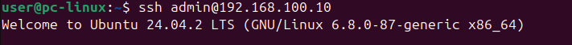

# SSH Access & Firewall – LabSec Solutions

Tento dokument popisuje hardening přístupu k Ubuntu Serveru:
přihlášení pomocí SSH klíče a omezení SSH ve firewallu UFW
pouze na administrační stanici.

## Použité systémy
- Ubuntu Server: cílový uzel (192.168.100.10)
- Ubuntu Desktop: administrační stanice (192.168.100.20)
- Interní síť: LAN1 (VirtualBox Internal Network)

---

## Verifikace přístupu a zabezpečení
Cílem je prokázat, že:
- přihlášení na server probíhá pomocí SSH klíče (bez zadání hesla)
- firewall UFW povoluje SSH pouze z adresy administrační stanice

## Použité příkazy

```bash
# Desktop: přihlášení na server (proběhne bez hesla díky SSH klíči)
ssh admin@192.168.100.10

# Server: kontrola pravidel firewallu
sudo ufw status

# Server: kontrola přihlášených relací
who
```

## Výsledek
- **Autentizace:** přihlášení proběhlo bez výzvy k zadání hesla (Ed25519 klíč). Pro srovnání: při prvním testu ([ssh_tests.md](./ssh_tests.md)) server heslo vyžadoval.
- **Firewall:** UFW je aktivní (`Status: active`). Port **22/tcp** je povolen **pouze z 192.168.100.20**. Port **80/tcp** zůstává povolen z libovolné adresy kvůli webovému serveru.
- **Relace:** příkaz `who` potvrzuje, že uživatel `admin` je připojen (`pts/1`) z adresy administrační stanice 192.168.100.20.

## Důkaz



## Srovnání pravidel UFW

| Port | Před hardeningem ([firewall.md](./firewall.md)) | Po hardeningu |
| :--- | :--- | :--- |
| 22/tcp (SSH) | Anywhere (IPv4 + IPv6) | pouze 192.168.100.20 |
| 80/tcp (HTTP) | Anywhere (IPv4 + IPv6) | Anywhere (IPv4 + IPv6) |

## Další doporučení
Přihlášení klíčem samo o sobě nevypíná přihlášení heslem. Pro úplný
hardening je vhodné v `/etc/ssh/sshd_config` nastavit
`PasswordAuthentication no` a `PermitRootLogin no` a ověřit to
pokusem o přihlášení heslem.

## Závěr
SSH klíčová autentizace ve spojení s omezením SSH ve firewallu UFW
minimalizuje riziko neautorizovaného přístupu. Správa serveru je
na úrovni sítě omezena na jedinou administrační stanici (princip
nejnižších privilegií).

[← Zpět na hlavní přehled](../README.md)
